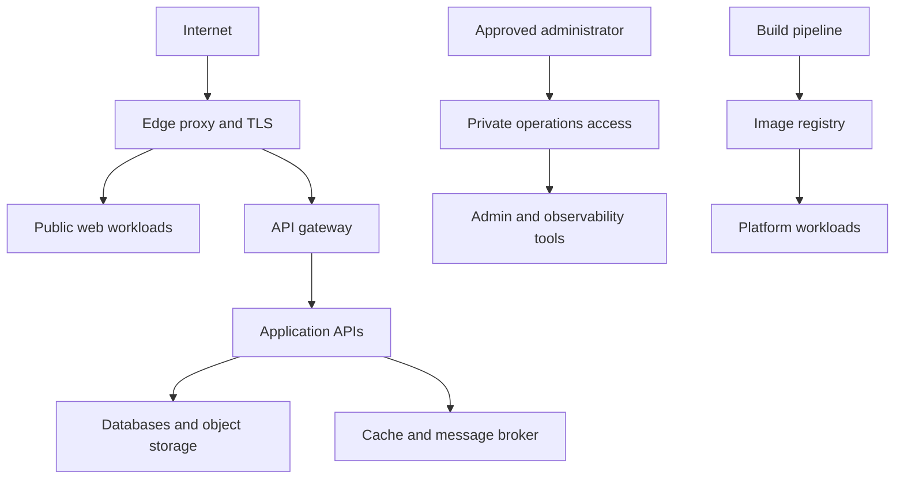

## Platform shape

This is a conceptual reference. It does not imply that every platform needs every component.

The runnable Compose slice in `demo/` exercises the edge-to-API-to-database path. The separate `demo/swarm-stack.yaml` and `demo/swarm-smoke-test.sh` exercise the same API and PostgreSQL path as a one-node Swarm stack. The Swarm services have no published ports; the exercise uses a temporary attachable overlay and a local synthetic secret, then removes its own resources. Neither demo mounts the Docker socket or configures public TLS.

## Boundary decisions

- The edge proxy handles incoming connections, TLS, and host/path routing.
- An API gateway handles API-specific policies such as authentication integration, rate limits, and request transformation.
- Application services own business behavior; data services remain private to workloads that need them.
- Administrative tools have a separate access policy from public applications.
- Delivery automation builds and publishes versioned images; deployment and rollback remain explicit operations.

## Operational proof

The runnable examples cover the request path and the Swarm scheduling/network boundary. Private homelab access and backup/restore demonstrations live in the companion [Zero Trust Homelab](https://github.com/HassanTaj/zero-trust-homelab) repository. These local exercises do not deploy to a VPS or provide production rollback evidence.

## Lessons extracted from operated systems

These are design lessons, not copied deployment instructions:

- Keep the edge proxy and API gateway distinct. The edge owns TLS and host routing; the gateway owns API policies and compatibility routes.
- Model the active orchestrator as the source of truth. Retained Compose files may be useful for local development or rollback, but must be labeled as such and must not silently contradict the deployed Swarm definition.
- Separate public workloads from administration panels and give each an explicit access boundary.
- Treat image publishing, deployment, and rollback as separate steps. Stateful services should not be updated merely because a newer image exists.
- A backup schedule is not proof of recoverability. State the actual covered datasets, off-host boundary, measured restore evidence, and any RPO/RTO gaps.

The source experience also showed why dashboards and logs need threat modeling: headers can carry credentials and query strings may remain sensitive even when header logging is disabled. Examples here should specify retention and redaction assumptions rather than claiming logs are automatically safe.
